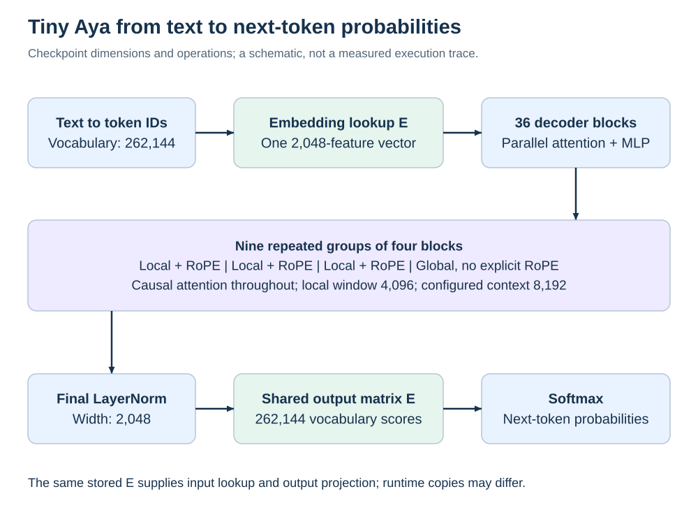

# Model structure and tensor vocabulary

## What a decoder does

A decoder-only language model receives token IDs representing a prefix and predicts a probability distribution for the next token. Generation selects a token from that distribution, appends it to the prefix and repeats. The architecture defines the computations; the learned weights determine their numerical behavior. Quantization changes how weights are represented while usually preserving their matrix dimensions and the overall computation graph.

For our inspected Tiny Aya Global, the important dimensions are:

| Quantity | Value | Meaning |
| --- | ---: | --- |
| Vocabulary size | 262,144 | Number of token IDs addressed by the embedding/output matrix |
| Hidden width | 2,048 | Features in each token's residual vector |
| Decoder blocks | 36 | Successive residual updates |
| Query heads per block | 16 | Separate attention queries, each 128 features wide |
| Key/value heads per block | 4 | Shared by groups of four query heads |
| MLP intermediate width | 11,008 | Channels after the up and gate projections |
| Local attention window | 4,096 | Configured local causal window |
| Configured maximum context | 8,192 | Scope of this checkpoint's inspected context configuration |
| Stored parameters | 3,349,227,520 | Counted once per stored tensor |

These are facts about the inspected checkpoint, not universal settings for every Aya variant. The [configuration evidence](../../reports/stage1-downloaded/inspection.json) and [generated atlas](data/atlas.json) are the numeric authority.

## Terms that refer to different objects

| Object | What it is | Tiny Aya example | What an intervention could change |
| --- | --- | --- | --- |
| Token | An ID for a vocabulary unit | A subword, punctuation or byte-related unit | Segmentation or vocabulary; this affects model compatibility |
| Residual vector | The current representation of one token | 2,048 real numbers at a block boundary | Activation patching or a learned representation correction |
| Block or decoder layer | A complete residual update | One of 36 parallel attention/MLP blocks | Branch scaling, removal or replacement |
| Branch | One computational path inside a block | Attention or MLP | Restore one path while holding the other fixed |
| Weight matrix | Learned coefficients of a linear operation | `mlp.down_proj.weight` | Precision, scaling, permutation, rank or shape |
| Head | An attention subspace and its operations | One of 16 query heads | Head pruning or cache policy; not a separate stored tensor here |
| Channel | One coordinate in a chosen representation | One of 11,008 MLP intermediate coordinates | Rescale, reorder or remove with required compensation |
| Activation | A value computed for a particular input | The output of the gate on a Bangla prefix | Observe, patch or perturb at a defined boundary |
| KV cache | Input-dependent key/value history | Cached attention states during decoding | Retention or precision policy, separate from weight precision |
| Tensor | A numerical array of any rank | A matrix or normalization vector | Depends on its role; “tensor” alone says little |

A neuron/channel need not correspond to a human concept, and a matrix need not have one language-specific job. Channels are coordinates in a jointly trained representation. Renaming a group “reasoning” does not establish its function.

## The complete path



Using column-vector notation, token ID `t` selects one row from the stored embedding `E`, whose shape is vocabulary × hidden width. Treat that selected row as the initial hidden column `h_0`. Each block produces a new hidden state. The final LayerNorm produces `n`, and the vocabulary scores are `z = E n`, multiplied by the checkpoint's logit scale of 1.0. Softmax converts scores into probabilities. Input lookup and output projection use the same stored source matrix in the pinned native loader.

For block `l`:

```text
x_l       = LayerNorm_l(h_l)
a_l       = Attention_l(x_l, permitted prefix and cache)
m_l       = MLP_l(x_l)
h_(l+1)   = h_l + a_l + m_l
```

Both branches use `x_l`. The MLP at this block does not consume `h_l + a_l`. Nevertheless, the next block receives their sum, so an intervention affects both branches at every later depth. This distinction changes where a hook must be placed and what a branch-restoration result means. The [source ledger](sources.md) identifies the native graph and reference decoder functions that establish this ordering.

## Local and global depth pattern

Human layers 1–3 are local and layer 4 is global; the pattern repeats nine times. There are **27 local blocks and nine global blocks**. The human global layers are 4, 8, 12, 16, 20, 24, 28, 32 and 36. Code uses zero-based indices, so those are blocks 3, 7, 11, 15, 19, 23, 27, 31 and 35.

Local attention applies rotary position transformations to Q and K and uses the causal sliding mask. Global attention is causal over available history but applies no explicit RoPE in the inspected implementations. That does not make the global path unaware of order: its incoming states have already passed through position-sensitive computation, and its mask is causal. The [full block map](data/layer-map.md) makes the index conversion explicit.

“Early, middle and late” are useful sampling categories. They are not verified assignments of syntax, meaning and reasoning. Such assignments require behavioral interventions with appropriate controls, and can vary with input, task and model size.

## Stored matrices and normalization vectors

Every block stores seven matrices: Q, K, V, attention output, MLP gate, MLP up and MLP down. It also stores one LayerNorm scale vector. Across 36 blocks, that gives 252 matrices and 36 vectors. Add the shared embedding matrix and final normalization vector: **253 matrices + 37 vectors = 290 tensors**.

The GGUF control stores the matrices as BF16 and normalization vectors as F32. That is why multiplying every stored parameter by two bytes does not exactly reproduce the control file. Metadata, token strings and alignment also consume bytes. See the [complete group accounting](data/group-map.md).

Shapes use two conventions. PyTorch linear weights use `[output features, input features]`; the inventory reports GGUF dimensions in the reverse order for these matrices. For example, down projection is `[2048, 11008]` in PyTorch and `[11008, 2048]` in GGUF. Swapping a row operation and a column operation by confusing these conventions would target the wrong coordinates. The [CSV atlas](data/tensor-map.csv) provides both shapes and exact name mappings for every tensor.

## What is known and what remains an experiment

Architecture and storage establish that a value projection transforms the information attention combines, that MLP down maps 11,008 features to 2,048, and that the embedding participates at both ends. They do not establish which site is most sensitive to compression, which site is most valuable per byte, or whether Bangla and English prefer different precision placements. Those are three distinct empirical questions.

A source-code reading establishes a computation graph, not a complete theory of the learned representation. The rest of this bank uses that graph to define testable interventions rather than attaching an unsupported semantic story to each layer.
