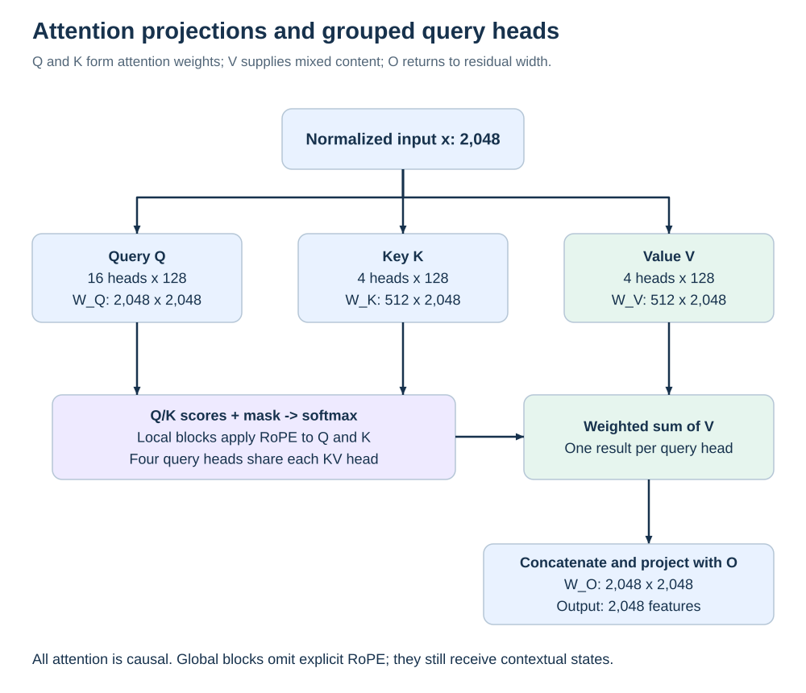

# Attention and context

## Queries and keys choose mixtures of values

Attention lets a token's current representation combine information from permitted token positions. At a block, project the normalized hidden state through three separate matrices:

```text
q = W_Q x       k = W_K x       v = W_V x
score(i,j) = dot(q_i, k_j) / sqrt(128) + mask(i,j)
weight(i,:) = softmax(score(i,:))
head_output(i) = sum_j weight(i,j) * v_j
attention_output = W_O concatenate(head_outputs)
```

The mask sets forbidden scores effectively to negative infinity. Q and K affect which positions are weighted; V affects the contents being mixed; the output projection maps the concatenated head results back to the residual width. These are computational roles. “What the query asks” is an analogy for a learned projection, not a literal symbolic question. [Attention formulation](https://arxiv.org/abs/1706.03762), [inspected Cohere2 implementation](sources.md).



The computation is nonlinear because scores pass through softmax. A small perturbation to Q or K can materially change a near-tied attention distribution. A V perturbation changes the mixture's contents even when the weights at that block are fixed. Either can change later blocks' attention weights through the updated residual stream. It is therefore incorrect to infer that Q/K are always more important, or that V errors stay confined to values.

## Exact matrix dimensions

| Matrix | PyTorch shape | Parameters per block | Input and output |
| --- | --- | ---: | --- |
| Q | 2,048 × 2,048 | 4,194,304 | Produces 16 query heads × 128 features |
| K | 512 × 2,048 | 1,048,576 | Produces four key heads × 128 features |
| V | 512 × 2,048 | 1,048,576 | Produces four value heads × 128 features |
| O | 2,048 × 2,048 | 4,194,304 | Returns 16 concatenated query-head outputs to residual width |

These four matrices contain 10,485,760 parameters per block. The matrix names and actual file formats are in the [tensor atlas](data/tensor-map.csv). There are no attention projection biases in the inspected configuration.

## Grouped query attention

Tiny Aya has 16 query heads but four key/value heads. Four query heads share each KV head. This is grouped-query attention, or GQA. It reduces K/V projection weights and the amount of K/V history relative to an otherwise equivalent 16-KV-head model. It does not reduce the number of query-head outputs to four. [GQA paper](https://arxiv.org/abs/2305.13245).

A whole V matrix intervention changes all four KV heads at that block. A head-specific intervention would need to identify the correct rows and their layout. Because a KV head is shared, modifying it affects the information available to multiple query heads. Whole-matrix sensitivity cannot tell us which of those heads was responsible.

Changing the architecture from four KV heads to fewer heads is also different from changing the precision of the existing V matrix. It changes shapes, sharing and runtime assumptions, and may require training or distillation. A successful quantization experiment does not validate head-count surgery.

## Local and global attention have different access

A local block has the configured 4,096-token causal window; a global block can attend across the available causal prefix within the run's configured context. Both prohibit looking at future tokens. When a short prefix fits entirely inside the local window, local and global masks may allow the same prefix positions. Their learned weights and position treatment still differ.

The frozen C8 probe uses short excerpts. It therefore cannot establish the value of a 4,096-token window versus longer retrieval. Its local/global V comparison concerns two specific sites under those excerpts. A later long-context experiment would need controlled relevant-information positions, distractors, lengths and a runtime whose masking/cache behavior has been verified at those lengths.

This is an important limit on the first eight-site design: comparing block 0 with block 3 changes depth as well as attention type. It is not a factorial estimate of the local/global effect. Multiple depth-matched groups, and checks below and beyond the window, would be needed for a stronger mechanism claim.

## Rotary positions

RoPE rotates paired Q/K coordinates as a function of token position. In the reference implementation, these rotations are applied only at local-attention blocks. K/V grouping, RoPE and the causal mask are separate mechanisms. V is not directly RoPE-rotated here, but it is computed from a representation that contains contextual and positional information.

The configured rotary base is 50,000 and head dimension 128. The reference uses interleaved coordinate pairs. A permutation or rotation of Q/K coordinates must preserve or explicitly compensate the position operation. Matching matrix sizes is insufficient to establish an equivalent transformed model. An arbitrary “rotate all weights” recipe imported from another architecture is unsafe without an algebraic derivation and full-precision parity check.

## Prefill and decoding

During prefill, the model processes a supplied prefix and creates attention states. During autoregressive decoding, it computes a new token's states and reuses stored K/V for earlier tokens. This cache is input-dependent; it is not the learned parameter file. Quantizing weights affects newly computed cache values but does not, by itself, change the cache's chosen storage dtype.

Changing weights or branch behavior and then continuing with an old cache mixes incompatible computations. For a controlled intervention, start a fresh compatible prefill unless the experiment explicitly studies and validates a state-conversion scheme. Setting an attention branch's output to zero after calculating it can test an effect, but it does not remove the attention compute or its stored weights.

## A cache-size calculation

For one sequence, assuming K and V each have two bytes per element:

```text
bytes per cached token per block
  = 2 (K and V) * 4 KV heads * 128 features * 2 bytes
  = 2,048 bytes
```

If all 36 blocks retained all 8,192 token positions, their raw K/V elements would total 603,979,776 bytes, or 576 MiB. If the 27 local blocks retained at most 4,096 positions and the nine global blocks retained 8,192, the raw total would be 377,487,360 bytes, or 360 MiB. These are mathematical element counts under stated assumptions, not measured process RAM. Cache allocation, padding, temporary buffers, quantization scales, activations and backend policies are additional considerations. A runtime may allocate more than the ideal retained history.

## What to measure before changing attention

Start with the claim: restoring a selected projection should recover specified prediction behavior at a specified cost. Observe reconstruction error, attention distributions only as diagnostics, whole-model KL and task outcomes. Record layer type, prefix length, cache state, precision and actual bytes. Compare same-role sites across more than one depth before generalizing. Use held-out discovery/confirmation material rather than choosing the most attractive attention map after viewing every outcome.

The current selection includes V to keep a small, same-shape pair feasible. It omits Q, K and O. Those omissions are budget decisions, not evidence that the omitted matrices are insensitive or unimportant.
