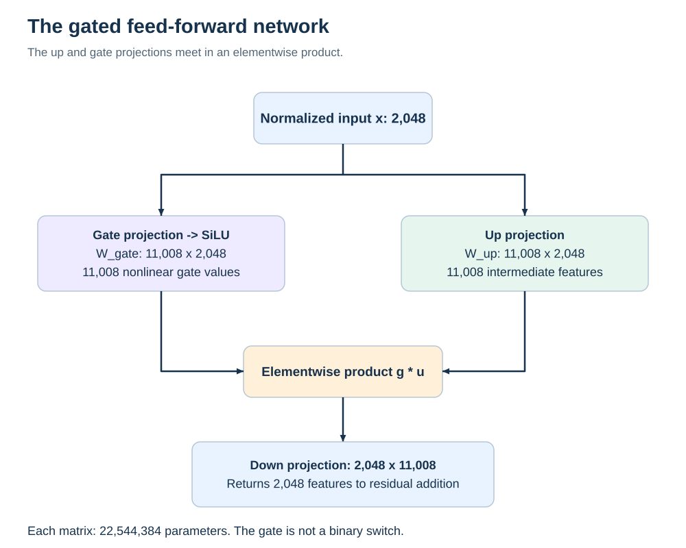

# Feed forward network and residual stream

## What the MLP computes

The feed-forward branch, often called the MLP or FFN, applies the same learned transformation independently at each token position. At a given block, token-to-token mixing occurs in attention. The MLP receives the contextual representation already present in the shared normalized input, so “independently by position” does not mean “without context.”

Tiny Aya's gated MLP uses:

```text
u = W_up x                    # 2,048 -> 11,008
g = SiLU(W_gate x)             # 2,048 -> 11,008
z = g * u                     # elementwise product
m = W_down z                  # 11,008 -> 2,048
SiLU(s) = s * sigmoid(s)
```

The up projection creates intermediate features. The gate projection creates a second set of features and transforms them nonlinearly before their elementwise interaction. Down projection recombines those products into the residual width. The gate is not a binary switch and is not restricted to values between zero and one: SiLU can be negative and can exceed one. [GLU variants](https://arxiv.org/abs/2002.05202), [actual reference functions](sources.md).



Each matrix has 22,544,384 parameters. The three together have 67,633,152 per block. Across all blocks, MLP matrices contain 2,434,793,472 parameters, about **72.70% of the model**. That makes their representation a major storage opportunity, but does not prove they dominate behavioral sensitivity.

## Why equal parameter counts do not imply equal damage

Gate, up and down participate differently in the nonlinear computation. Changing gate weights can alter which intermediate products are amplified or suppressed. Changing up weights perturbs one factor of those products. Changing down weights alters how the final intermediate representation is read back into the residual stream.

The same matrix error norm can therefore produce different activation errors. Even equal activation errors can cause different prediction changes because downstream computation depends on direction, not just magnitude. No ordering among gate/up/down follows from their names. A claim that “down is most important” must specify the model, format, input distribution, background precision and outcome.

An intermediate channel is also a coordinate shared by gate, up and down. A channel removal must remove the corresponding rows of gate/up and column of down together, with the model/export dimensions updated. Zeroing only one row is a behavioral ablation with different numerical and cost consequences.

## The residual stream combines both branches

At a Tiny Aya block, normalize the incoming residual once, compute attention and MLP from that normalized input, then add both outputs to the residual. A proposed scalar control interface can be written:

```text
h_next = h + alpha * Attention(LayerNorm(h))
           + beta * MLP(LayerNorm(h))
```

The unchanged model has alpha = beta = 1. These controls are an explanatory proposal; the frozen native quantization pilot changes stored precision rather than inserting alpha/beta controls. Setting beta to zero can test the contribution of the MLP branch under that intervention. It does not automatically save file bytes, and multiplying a fully computed result by zero does not save its compute.

The branches can compensate for one another through joint training and later layers. A small branch-output norm is not proof that its contribution is dispensable; a small directional update can change the top two output candidates. A large norm is not proof that the branch improves correctness. Norms are measurements to interpret alongside a causal perturbation and endpoint.

## LayerNorm is part of the computation

For a hidden vector h with d = 2,048:

```text
mu  = mean(h)
var = mean((h - mu)^2)
x   = gamma * (h - mu) / sqrt(var + epsilon)
```

The inspected implementation uses a learned scale gamma, no learned normalization bias, and epsilon = 1e-5. It computes the normalization statistics in float32 in the reference path. RMSNorm would omit the mean subtraction and normalize a different quantity. A rotation/scaling proof for an RMSNorm model cannot simply be assumed to hold here.

The 37 normalization vectors contribute very few bytes and are F32 in the GGUF references. The eight-site pilot leaves them unchanged. Low byte share does not imply no numerical importance; it means quantizing them offers little direct file saving in this particular artifact.

## An exact channel-scaling symmetry

There is a useful way to change numerical ranges while preserving the mathematical MLP function. Let D be a diagonal matrix of bounded, positive, nonzero channel scales. Define:

```text
W_up_new   = D W_up
W_down_new = W_down D^-1
W_gate_new = W_gate
```

The new intermediate feature is D u. Since D is diagonal, multiplying g elementwise by D u gives D(g * u). The new down projection cancels D exactly. Thus the MLP's unquantized function is unchanged in exact arithmetic. This is an algebraic consequence of the stated computation, not an observed Tiny Aya improvement.

Why investigate it? Quantization approximates each transformed matrix separately, and generally does not commute with this rescaling. A numerically equivalent full-precision model can therefore yield a different quantized model. [AWQ](https://arxiv.org/abs/2306.00978) provides prior art for activation-aware equivalent scaling, but does not establish that this exact Tiny Aya proposal wins under our native formats.

In finite precision, extreme scales can overflow, underflow or change rounding. The first required experiment would be unquantized parity across representative inputs, followed by fixed-format quantization with identity, English-informed, Bangla-informed and pooled transformations at equal actual bytes. This is an alternative intervention family, separate from changing which tensors receive more bits.

## A channel-permutation symmetry

Let P permute intermediate channels. Permute gate and up rows by P and down columns by the inverse permutation. Elementwise SiLU and multiplication commute with a consistent permutation, so the exact function remains unchanged. A block quantizer may produce different errors when the same channels are regrouped in storage.

Whether a specific permutation changes native quantization depends on its actual row/block grouping. A permutation confined to a quantization-invariant grouping may do nothing. Verify the relevant layout rather than assuming any reorder is beneficial.

Scaling the input to SiLU and dividing afterward is generally not an equivalent transformation, because SiLU is nonlinear. General orthogonal rotations do not commute with the elementwise gate product. These are reasons to derive the transformation for the actual graph before implementing it.

## What a restoration or patching experiment would mean

Restoring one BF16 MLP branch inside an otherwise quantized model asks how useful that repair is along the quantized model's current trajectory. Replacing a whole hidden state with the teacher's hidden state asks whether resetting accumulated error at that boundary helps. The latter can repair damage introduced earlier and therefore cannot attribute all recovered quality to the patched layer.

The existing degrade-one pilot asks a third question: how much damage is introduced by compressing one matrix inside an otherwise BF16 model? Its result may rank promising sites, but interactions in a fully quantized model can change that order. A complete candidate export must eventually be evaluated as a complete model.
