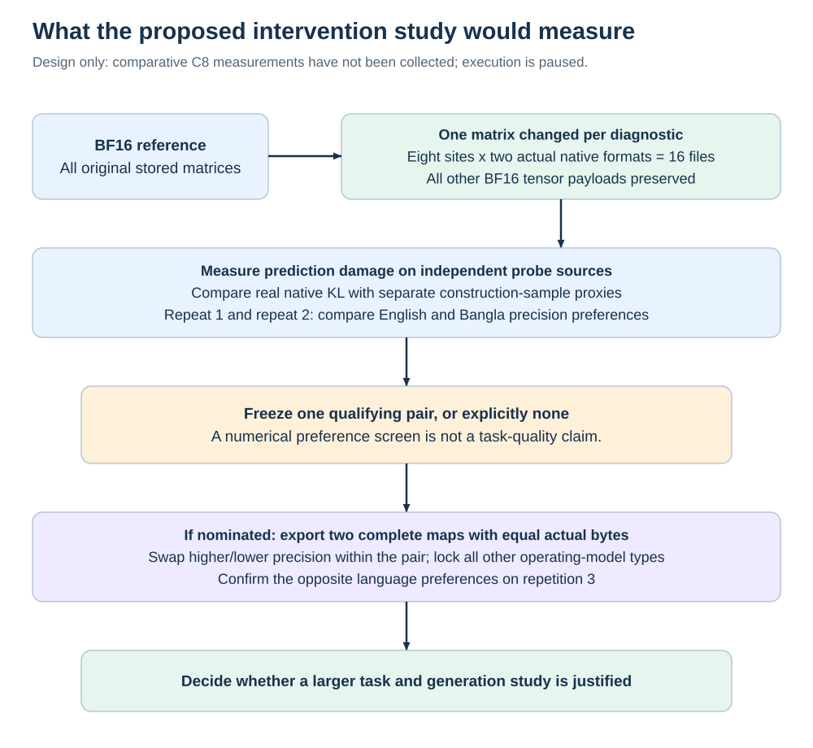

# Compression and damage measurements

## Quantization changes a representation

Quantization approximates numerical values with a smaller set of stored codes, together with scales and other block metadata. At inference, the runtime uses compatible kernels to reconstruct or directly multiply those representations. A nominal three-bit family does not mean exactly three bits for every parameter in the final file.

A file label such as Q3_K_M selects a native export recipe with different stored tensor types. The [actual operating inventory](data/tensor-map.csv) shows Q6_K for the embedding, Q5_K for the first V and down matrices, Q4_K for several other selected sites, and Q3_K for the selected middle gate/up. The control's normalization vectors remain F32. Precision allocation must operate on these actual types and byte costs rather than assuming the label is uniform.

The completed [T3 curve](https://github.com/grinder81/polyglot-quant-eval/blob/34db052fc98de4c15b511d831fe23f77d8c3153f/results/t3-precision-curve/final/README.md) selects the existing Q3_K_M as a development operating point under the frozen English floor. The task tables and their uncertainty stay in that evaluation repository. This chapter explains how to interpret the instrument, not a new result.

## Weight precision, activations and caches

| Quantity | Persists as learned model content? | Depends on the input? | A separate precision choice? |
| --- | --- | --- | --- |
| Weight tensors | Yes | Their values do not | Yes |
| Hidden activations | No | Yes | Yes |
| Attention KV cache | No | Yes | Yes |
| Saved reference logits | No | Yes | Yes, for measurement storage |

Weight-only quantization does not imply that activations or KV cache use the same low-bit format. File size, load-time copies, GPU allocation, peak process RAM and latency are different quantities. A smaller weight file can fail to produce a proportional speedup because kernels, bandwidth, dequantization, context and batch size change the bottleneck.

## Calibration and training are distinct operations

An importance matrix is collected by running representative text through the model and recording activation statistics that guide quantization. It can improve how numerical errors are distributed without updating the original model through optimizer steps. The result depends on data, token coverage and the chosen quantization procedure. [Official imatrix documentation](https://github.com/ggml-org/llama.cpp/blob/master/tools/imatrix/README.md).

The IQ3_S in our curve was exported **without an importance matrix**. Its result describes that artifact, not the best calibrated IQ3_S achievable. We have not measured a calibrated version. Its poor score does not prove that the absent calibration caused all of the loss; that causal claim would require a controlled calibrated/un-calibrated comparison.

The frozen C8 export uses real Q2_K/Q3_K formats without an importance matrix to isolate its chosen precision interventions. Adding Bangla calibration to one arm would change another variable. Language-informed format placement and language-informed quantizer calibration must be separated before they are combined.

Quantization-aware training or distillation updates weights with a training objective. A Fisher diagnostic computes gradients, but with no optimizer step those gradients are measurements rather than training. These mechanisms need different resource budgets and provenance. Our current sensitivity experiment trains no weights.

## Three levels of error

**Weight reconstruction error** asks how far a reconstructed matrix is from its original values. A simple measure is the sum of squared differences, often normalized by parameter count or original energy. It is cheap but ignores which input directions are used and how errors propagate.

**Local activation error** asks how a matrix perturbation changes its output for specified inputs. For a linear operation, delta-y = delta-W x. Ignoring cross-channel correlations gives an approximation proportional to a sum of squared weight errors weighted by input activation energy. It remains an approximation: correlated inputs and downstream nonlinear effects are omitted.

**Whole-model output damage** asks how the final next-token distribution changes after the intervention. The pilot measures KL(BF16 || candidate), averaged over defined token positions and source examples. That includes downstream effects of a one-tensor intervention under its specified background precision.

The three can disagree. Two matrices with equal weight MSE can affect different input directions, and equally sized local errors can align differently with output decision boundaries.

## What KL tells us

For teacher probabilities p and candidate probabilities q over the same vocabulary:

```text
KL(p || q) = sum_v p(v) * [log p(v) - log q(v)]
```

It measures a directional distribution difference and is zero for identical distributions in exact arithmetic. Compute it with stable normalization and adequate reduction precision. The locked pilot uses float64 normalization in chunks of at most eight vocabulary rows, with exact token/source identity checks. A negative value of meaningful size would indicate a numerical or implementation problem, not “better-than-zero fidelity.”

Low KL does not mean the teacher is correct. A candidate can improve a task while changing its predictions, or preserve an incorrect teacher answer faithfully. Small average KL can also hide a consequential change on a few low-margin decisions. This is why task correctness, answer churn, paired accuracy differences and genuine generation judgments remain separate endpoints.

Correctness discordance is not the same as changed answers. If both models choose different wrong answers, answer churn increases but paired accuracy does not change. Power calculations for a paired accuracy comparison must use the relevant correctness discordance and source-cluster structure.

## The exact Fisher proxy in this pilot

Let e be the quantization error for the selected matrix. For source example s, let g_s be the gradient of its mean next-token negative log likelihood over 64 content tokens. The proxy is:

```text
score_Fisher = 0.5 * sum_i e_i^2 * mean_s[(g_s,i)^2]
```

Square each example's gradient before averaging. Squaring a gradient averaged across examples allows cancellation and computes a different statistic. This estimator is **sequence-level empirical Fisher**; it is not token-wise Fisher and not the exact Hessian of output KL. Because g_s is already a gradient of a token mean, changing the sequence normalization changes its scale.

The tied embedding receives contributions from both lookup and output uses. The proxy implementation must check their parameter identity, imported checkpoint matrices and token IDs. It uses a separate differentiable reference path, so matching weight arrays does not establish whole-runtime numerical identity with native GGUF execution.

The activation proxy weights e-squared by input activation energy, with special accounting for the embedding lookup and head. Both proxies are cheaper hypotheses about damage ranking. The pilot compares them to real native outputs rather than assuming either is a substitute.

## One tensor in BF16 versus a complete compressed model



A degrade-one export compresses exactly one selected tensor, preserving every other BF16 payload. That estimates damage around an otherwise high-precision background. A repair experiment restores one tensor inside a compressed model and estimates value around a damaged background. They need not produce the same ranking because later activations and interactions differ.

An additive cost table approximates a complete allocation by adding isolated costs. Its usefulness for **ranking choices** and its accuracy for **predicting damage magnitude** must be checked separately. Even a useful ranking does not guarantee exact KL values, and neither guarantees a task gain. The independent complete-map comparison in the pilot is a minimal check on whether an isolated preference survives composition.

## Bytes and uncertainty govern the decision

Compare two allocations at identical actual shipped bytes, including tokenizer or auxiliary artifacts not already embedded in the GGUF. File padding provides no useful control. Different untouched defaults/uniform recipes can have different bytes; label them honestly rather than calling them matched.

Separate variation across construction samples from task uncertainty across questions/source clusters. A strong difference between languages in one sample can be smaller than within-language sample variation. Source-disjoint confirmation addresses repeatability; it does not create a broad confidence guarantee from three tiny repetitions.

The pilot's discovery/confirmation rule is an investment screen with a numerical epsilon, not a test of a practically meaningful accuracy effect. The holdout, human generation review and task-benefit criterion remain separate. See [selection limits](06-eight-site-selection.md) before turning a heatmap into a research claim.
