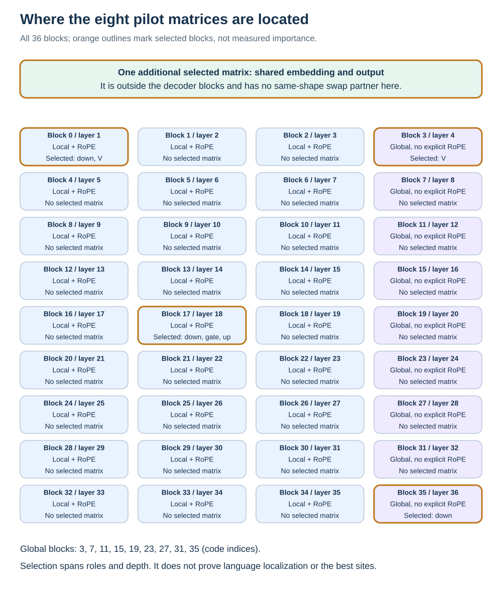

# Why these eight sites were selected

## The selection is a design choice

The eight sites were fixed before comparative language outcomes. They provide a small, deliberately varied screen across the shared language interface, attention and MLP roles, and depth. They were not selected from a completed Tiny Aya sensitivity ranking. Eight is a practical experimental budget, not an optimal count derived from theory. Prior compression research motivates investigating nonuniform sensitivity, but does not identify these exact indices as optimal for this model.

The selected matrices contain 651,689,984 stored parameters, about 19.458% of the model. The 536,870,912-parameter embedding dominates that fraction. It is not an unbiased 19.458% sample of functions, heads, languages or failure modes. All exact names, shapes, actual existing types and pair budgets appear in the [generated eight-site table](data/eight-sites.md).

## The rationale and limitation for each site

| Site | Question it helps ask | Why this particular placement | What it cannot establish alone |
| --- | --- | --- | --- |
| Shared embedding/output | Is the shared vocabulary interface sensitive under the tested compression? | Large parameter share and dual use make it a distinct component class | Whether lookup or output caused an effect; a language-specific embedding mechanism |
| V at block 0, human layer 1 | How does an early local value projection respond? | First block gives an early local site and an equal-shape partner for block 3 | Whether the effect comes from being early or local |
| V at block 3, human layer 4 | How does the first global value projection respond? | First global block provides the contrasting site with matching dimensions | A general local/global causal effect across depths or long contexts |
| Down at block 0, human layer 1 | Is early MLP output projection precision valuable? | Same role and shape as middle/late down projections | That the layer is a universal “syntax” stage |
| Down at block 17, human layer 18 | What changes at a middle depth? | A prespecified central sample and shared anchor for two pairs | That the exact midpoint is optimal or represents all middle layers |
| Down at block 35, human layer 36 | How does the final MLP down projection respond? | Gives a late endpoint near the final normalization/output | That it is responsible for all final prediction errors |
| Gate at block 17, human layer 18 | How sensitive is the nonlinear gate path? | Holds block position fixed when compared with up; shapes match | That a low score makes all gates expendable |
| Up at block 17, human layer 18 | How sensitive is the other factor in the MLP product? | Same block and matrix dimensions as gate | That gate/up are independent or interchangeable operations |

The middle choice is a fixed representative index. We have not established a mechanistic reason that block 17 should be preferred to block 16 or 18. That uncertainty is a reason to broaden a justified later study, not to invent a retrospective explanation.

## Why value projections rather than every attention matrix

The two V matrices share the same shape, have relatively small export deltas and span the first local/global contrast within the finite pilot. They make a clean byte-swapping pair. Q, K and O remain omitted. There is no Tiny Aya result here showing that V is the most important attention role or the best use of extra precision.

Their omission matters: Q/K perturbations can change softmax routing, while O changes how head outputs enter the residual. A V-only attention sample cannot rank those alternatives. A later scan should either cover those roles systematically or explicitly narrow its claim to V.

## Four restricted swaps and their budgets

For each eligible pair, define map A with higher precision at the first site and lower at the second; map B reverses those assignments. All other tensors are locked to the operating Q3_K_M inventory. The mechanically selected formats are native Q2_K and Q3_K, based on the operating gate type before language probes.

| Fixed pair order | Pair | Predicted bytes for either complete map |
| ---: | --- | ---: |
| 1 | V at blocks 0 and 3 | 1,799,224,832 |
| 2 | Down at blocks 0 and 17 | 1,788,644,864 |
| 3 | Down at blocks 17 and 35 | 1,791,462,912 |
| 4 | Gate and up at block 17 | 1,797,451,264 |

These are mechanically derived eligibility predictions, not completed comparative pair-export measurements. Actual complete exports still must agree with predicted bytes, have equal bytes between orientations and preserve all nonpair payloads. Every predicted pair is within the 1,799,740,928-byte operating model and 2.2 GB ceiling. Different pairs do not share an identical budget; the matched claim is **within a pair**.

Matching works because each pair swaps formats across compatible matrix shapes and their verified native row costs. The embedding has no same-shape partner among the other seven selected matrices. It therefore supplies diagnostic information but is not one of the four restricted confirmation pairs. Expanding the allocation space to trade embedding bits against many smaller matrices would require a different design, with interactions and byte accounting addressed explicitly.

## How the existing discovery rule works

Each repetition has separate construction and probe sources. An individual-language arm has 192 content tokens; the pooled arm has the same total split across languages. Source-aligned English, Bangla and Hindi material is used, with token-truncation limitations recorded. Hindi contributes a diagnostic and pooled evidence; the nomination contrast is Bangla versus English.

For a selected tensor, estimate the KL reduction from raising it from the lower to the higher format. For a pair, subtract the second tensor's estimated reduction from the first's. A positive margin favors spending the higher precision on the first tensor.

Repetitions 1 and 2 can nominate a pair only when English and Bangla have opposite signs in both repetitions, each language keeps its sign, and each absolute margin exceeds the frozen 1e-5 nats/token epsilon. Take the first qualifying eligible pair in the fixed order, rather than the largest observed effect. Freeze the full nomination, including explicit none, before any repetition 3 comparative outcome.

A nominated pair is promising only if its two actual complete maps reproduce the opposite language preferences on the third independent probe sample. Pooled and Hindi outcomes and all other sites remain descriptive. The epsilon screens numerical triviality; it is not a threshold for practical task improvement or statistical proof of a general language effect. These details belong to the [frozen scientific protocol](https://github.com/grinder81/polyglot-quant-eval/blob/34db052fc98de4c15b511d831fe23f77d8c3153f/docs/c8-bounded-pilot.md), which this teaching document does not amend.

## Confounds and coverage gaps

1. **Depth and attention type are confounded.** Block 0 versus 3 changes both. Three down sites are useful samples, not a complete depth curve.
2. **Short text does not test long-context access.** Within the local window, mask access may be similar despite different position treatment and learned weights.
3. **One domain is limited.** Repeated TED talks address sample instability within that source family, not all domains or generation tasks.
4. **Fixed tokens can truncate different content.** Parallel source alignment does not guarantee equal semantics after truncation.
5. **Degrade-one is a BF16-background measurement.** Its costs can interact differently in a complete compressed model.
6. **No eight-site result establishes the best global allocation.** The embedding and omitted Q/K/O matrices can require different trade-offs.
7. **The exact existing recipes already protect selected sites differently.** A default format label is not a uniform starting treatment; actual assignments must be included in any causal comparison.

## How a broader selection could become justified

A later design could stratify all matrix roles across multiple local/global depths, use the same role at several positions within each four-block group, or inventory all 253 matrices with a validated cheap proxy followed by native confirmation. It should compare selection rules against random or evenly spaced controls and keep source/domain coverage independent of selection.

Those are prospective options. Their cost, proxy validity and expected decision value need to be compared before changing the frozen experiment. An inconclusive pilot could mean low power, narrow coverage or a weak hypothesis; it would not prove that no language-informed allocation can work.

## Current evidence status

The complete development precision curve and the eight-site execution plan are recorded. Diagnostic export was interrupted by a host-storage failure before comparative C8 native or proxy measurements began. No selected site has a published C8 sensitivity score, no pair has been nominated, and no layer-specific benefit is established. The user's subsequent instruction pauses execution while this architecture knowledge is developed.
