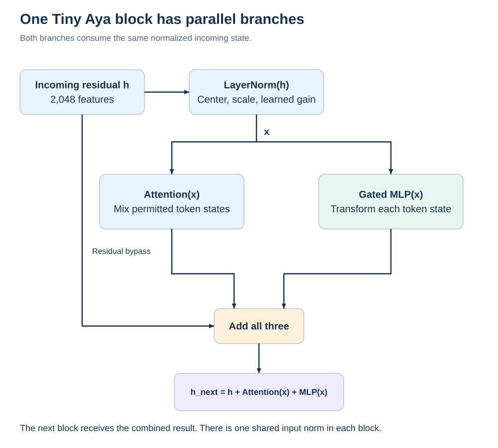

# Tiny Aya architecture and intervention knowledge bank

Understand the model before deciding where to change it. This reference connects Tiny Aya Global's actual stored tensors to its forward computation, compression mechanisms and the evidence needed to prioritize an intervention. It is intended for repeated study: start with the diagrams, work through the equations, then use the decision records to challenge a proposed experiment.

**The model experiments and Ubuntu recovery remain paused at the user's request.** Creating this knowledge bank runs no model, collects no outcome and changes no frozen experimental rule. The eight-site pilot is an existing proposal to understand, not an established importance ranking or a decision that learning must culminate in that particular experiment.

## Start with the actual block



Tiny Aya uses 36 decoder blocks. Inside a block, attention and the gated feed-forward network consume **the same LayerNorm output in parallel**. Their outputs are added to the incoming residual stream. Drawing attention followed by an MLP that consumes the attention result would describe a different computation. LayerNorm here subtracts the feature mean; replacing it with RMSNorm would also change the model. These details are established by the inspected configuration, Transformers reference and pinned native implementation in the [source ledger](sources.md).

## Learning path

| Read | What you should be able to explain afterward |
| --- | --- |
| [1 Model structure and tensor vocabulary](01-model-structure.md) | Distinguish a layer, branch, matrix, head, channel, activation and cache; trace a token through all 36 blocks. |
| [2 Attention and context](02-attention-and-context.md) | Explain Q, K, V and output projections; GQA; local/global masks; RoPE; and which state changes when a matrix changes. |
| [3 Feed-forward network and residual stream](03-mlp-and-residual.md) | Derive the gate/up/down computation, understand parallel branches and identify valid equivalent transformations. |
| [4 Tokenization and the shared language interface](04-tokenization-and-output.md) | Explain why the embedding is both a lookup and an output projection, and how tokenization can confound language comparisons. |
| [5 Compression and damage measurements](05-compression-and-measurement.md) | Separate file labels from actual types, weight error from output damage, and fidelity from task benefit. |
| [6 Why these eight sites](06-eight-site-selection.md) | Reconstruct each selection, the four restricted byte-matched pairs, omitted controls and the conclusions this subset cannot support. |
| [7 Intervention choices and prioritization](07-intervention-decisions.md) | Decide what evidence would justify allocation, calibration, balancing, restoration, pruning or more substantial architecture changes. |
| [8 Study questions and research notebook](08-learning-and-open-questions.md) | Explain the system without memorizing labels; keep source facts, hypotheses and results separate as knowledge grows. |
| [9 Segmentation inside a matrix](09-segmentation-and-controls.md) | Distinguish whole-matrix changes from head, channel, embedding-row and quantizer-block interventions. |
| [Glossary](glossary.md) | Look up terms and symbols without losing the argument. |
| [Sources and evidence boundaries](sources.md) | Find the configuration, original artifacts, source functions and experiment records behind a claim. |

Read chapters 1–4 before interpreting a tensor-importance heatmap. Read chapters 5–7 before selecting an intervention. The notebook contains worked questions and an evidence template for future findings.

## Architecture atlas

The [complete layer map](data/layer-map.md) lists all 36 blocks and their local/global pattern. The [group table](data/group-map.md) accounts for all parameters and payload bytes. The [eight-site table](data/eight-sites.md) shows the actual types in the existing Q4 and operating Q3 files. The [CSV](data/tensor-map.csv) and [JSON atlas](data/atlas.json) map **all 290 stored tensors** between Hugging Face and GGUF names, dimensions and formats.

These tables are generated by comparing the committed original tensor inspection, actual GGUF inventory and a hash-bound snapshot of the companion pilot plan. The generator checks complete membership, shapes, parameter sums, per-group accounting, file overhead and the 36-block pattern. It never opens model weights.

```powershell
py builds/build_tiny_aya_atlas.py --check
```

On Linux, use the equivalent `python` command. The generator has only standard-library dependencies. The [diagram generator](../../builds/draw_tiny_aya_knowledge.py) also writes SVG without model execution; optional PNG previews use Pillow.

## Important distinctions to retain

The model has **253 stored weight matrices plus 37 normalization vectors**, not 290 decoder layers. The original safetensors store all 290 tensors as BF16; the GGUF control stores the normalization vectors as F32. A format label such as Q3_K_M describes a mixed export recipe: its shared embedding is actually Q6_K. Exact shipped bytes and actual tensor types govern deployment claims.

About 72.70% of stored parameters are in MLP matrices and 16.03% in the shared embedding. These are opportunities to investigate, not importance scores. There is no established “Bangla layer” in this evidence. A computational role such as “query projection” is known from the architecture; a behavioral claim such as “this head retrieves Bangla morphology” requires a separate experiment.

The completed [development precision curve](https://github.com/grinder81/polyglot-quant-eval/blob/34db052fc98de4c15b511d831fe23f77d8c3153f/results/t3-precision-curve/final/README.md) supplies task/fidelity evidence in the evaluation repository. It does not yet establish a language-specific precision allocation. No phone performance, human generation judgment or final holdout result is added here.

## How this knowledge should grow

Keep explanations attached to an architecture revision and distinguish four kinds of statements: **structural fact**, **mathematical consequence**, **experimental observation**, and **hypothesis or design choice**. New data should update the relevant decision record, including negative results and uncertainty. A new idea does not modify a frozen protocol; propose a separate version when the scientific question changes.

The next discussion should be about which mechanism we understand well enough to test and what outcome would change our mind. It need not start with selecting another compression run.
